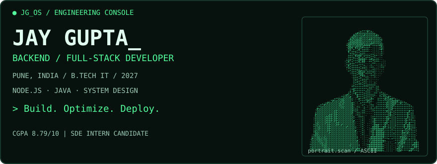

  

## Professional Overview

Backend-focused software developer pursuing a **B.Tech in Information Technology at MIT-ADT University, Pune**. Experienced in secure REST APIs, role-based applications and database-driven systems, with a focus on performance and reliability.

## Engineering Impact

## Technical Expertise

| Layer | Technologies |
|---|---|
| Programming | Java · Python · JavaScript · SQL · C++ (basics) |
| Backend | Node.js · Express.js · REST APIs · JWT · RBAC · Microservices concepts |
| Database | MySQL · MongoDB · Indexing · Schema design · Query optimization |
| DevOps | Docker · Kubernetes · GitHub Actions · Git |
| Cloud | AWS · GCP · Azure (fundamentals) |
| Frontend | React · HTML · CSS |
| Fundamentals | DSA · OOP · DBMS · OS · Networks · System Design · Testing |

## Professional Experience

### Backend Developer Intern — MIT SAP
**November 2025 – April 2026**

- Developed a MERN elective management application supporting **800+ students**.
- Implemented Student, Coordinator and Support role-based workflows.
- Automated Excel-based bulk onboarding and server-side validation.

### Website Developer Intern — MIT-ADT University
**May 2025 – June 2025**

- Developed and deployed a role-based event management platform for **500+ users**.
- Designed **15+ REST APIs** and reduced average response time by **30%**.
- Implemented JWT, RBAC, database indexing and query optimization.

## Featured Engineering Projects

<table><tr><td width="50%" valign="top">
<h3>Career Advancement Scheme</h3>

Faculty appraisal and administrative workflows.

<ul><li>100+ faculty members</li><li>9+ API-driven forms</li><li>RBAC and document uploads</li><li>MERN backend</li></ul>
</td><td width="50%" valign="top">
<h3>Scalable Event Booking</h3>

Performance and concurrency engineering.

<ul><li>1,000+ simulated concurrent users</li><li>Caching and rate limiting</li><li>Load testing</li></ul>
</td></tr></table>

## Research & Publication

**Campus Event Scheduling System (CESS): An Automated Role-Based Workflow for Academic Event Management**

IEEE IGNITE 2026 · Published 30 September 2026

## Achievements & Leadership

- IEEE IGNITE 2026 — published research co-author.
- Technical Head — College Council.
- 200+ DSA problems solved on LeetCode.

## Certifications

| Certification | Organization | Status |
|---|---|---|
| Docker & Kubernetes Masterclass | Coursera | Completed · Apr 2026 |
| Python Programming | IIT Bombay | Completed |
| Data Science Professional Certificate | IBM | In progress |

## GitHub Analytics

---

<b>Building reliable software. Engineering scalable solutions.</b>

