  

## `01 / WHOAMI`

Backend-focused software developer pursuing B.Tech in Information Technology at MIT-ADT University, Pune. I build secure REST APIs, role-based systems and database-driven applications with a focus on performance and reliability.

## `04 / TECH STACK`

| Layer | Technologies |
|---|---|
| Languages | Java · Python · JavaScript · SQL · C++ (basics) |
| Backend | Node.js · Express.js · REST APIs · JWT · RBAC · Microservices concepts |
| Frontend | React · HTML · CSS |
| Data | MySQL · MongoDB · Indexing · Schema design |
| DevOps | Docker · Kubernetes · GitHub Actions · Git · AWS/GCP/Azure (basics) |
| Engineering | DSA · OOP · DBMS · OS · Networks · System Design · Testing |

## `05 / EXPERIENCE LOG`

**Website Developer Intern — MIT-ADT University** · Jan–Jun 2025

- Built and deployed a role-based event management platform for 500+ users.
- Designed 15+ REST APIs and reduced average response time by 30%.
- Implemented JWT, RBAC, database indexing and optimized queries.

**Backend Developer Intern — MIT SAP** · Jul–Dec 2024

- Built a MERN elective management application for 800+ students on the campus network.
- Implemented Student, Coordinator and Support roles.
- Automated Excel-based bulk onboarding and added server-side validation.

## `06 / PROJECT REGISTRY`

| Project | Engineering highlights |
|---|---|
| Career Advancement Scheme (CAS) | MERN backend · 100+ faculty · 9+ API-driven forms · RBAC · document uploads |
| Scalable Event Booking | 1,000+ simulated concurrent users · caching · rate limiting · load testing |

## `07 / GITHUB TELEMETRY`

## `08 / CREDENTIALS`

- IEEE IGNITE-2026 — co-authored accepted research paper.
- Technical Head — College Council.
- 200+ DSA problems solved on LeetCode.
- Docker & Kubernetes Masterclass — Coursera, Apr 2026.
- Python Programming Certification — IIT Bombay.
- IBM Data Science Professional Certificate — in progress.

---

<code>END OF TRANSMISSION // KEEP BUILDING_</code>

