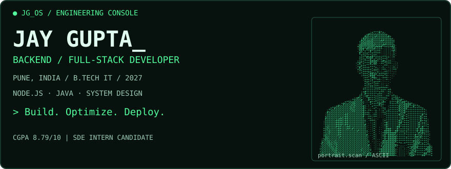

<div align="center">




[](https://www.linkedin.com/in/jay-gupta-68a41a290/) [](mailto:jayakhileshgupta1@gmail.com) [](https://github.com/Jaygupta2502)

</div>

---

## `01 / WHOAMI`

Backend-focused software developer pursuing B.Tech in Information Technology at MIT-ADT University, Pune.

I build secure REST APIs, role-based systems and database-driven applications with a focus on performance, scalability and reliability.

```bash
jay@engineering:~$ whoami

> Jay Gupta
> Backend Developer | Full-Stack Developer
> B.Tech Information Technology | 2027
> MIT-ADT University, Pune
> CGPA: 8.79 / 10

jay@engineering:~$ cat mission.txt

> Build secure backend systems.
> Optimize performance.
> Design scalable architectures.
> Deploy production-ready applications.
```

---

## `02 / ENGINEERING METRICS`



---

## `03 / PROFILE SCAN`


---

## `04 / TECH STACK`

| Layer | Technologies |
|---|---|
| Languages | Java · Python · JavaScript · SQL · C++ (basics) |
| Backend | Node.js · Express.js · REST APIs · JWT · RBAC · Microservices concepts |
| Frontend | React.js · HTML5 · CSS3 |
| Databases | MySQL · MongoDB · PostgreSQL · Indexing · Schema Design |
| DevOps | Docker · Kubernetes · GitHub Actions · Git · AWS · GCP · Azure (basics) |
| Engineering | DSA · OOP · DBMS · OS · Computer Networks · System Design |
| Tools | Postman · VS Code · GitHub · Linux |

<div align="center">


</div>

---

## `05 / EXPERIENCE LOG`

### `[01] Website Developer Intern — MIT-ADT University`

**May–Jun 2025 | Pune, India**

- Built and deployed a role-based event management platform for 500+ users.
- Designed 15+ REST APIs and reduced average response time by 30%.
- Implemented JWT, RBAC, database indexing and optimized queries.

**Engineering Focus:** `REST APIs` `JWT` `RBAC` `Database Optimization`

### `[02] Backend Developer Intern — MIT SAP`

**Nov 2025–Apr 2026 | Pune, India**

- Built a MERN elective management application for 800+ students on the campus network.
- Implemented Student, Coordinator and Support roles.
- Automated Excel-based bulk onboarding and added server-side validation.

**Engineering Focus:** `MERN` `Authentication` `RBAC` `Bulk Automation`

---

## `06 / PROJECT REGISTRY`

### `PROJECT_01 // CAREER ADVANCEMENT SCHEME`

**Career Advancement Scheme (CAS) — MERN Backend System**

```yaml
project: Career Advancement Scheme
architecture: MERN
users: 100+ faculty
deployment: College Intranet
status: Deployed
```

- Built and deployed a backend system for faculty career advancement workflows.
- Implemented secure Admin and Faculty role-based access.
- Developed 9+ dynamic REST API-driven forms.
- Supported structured data entry, document uploads and proof-link submissions.
- Optimized database queries using indexing.

### `PROJECT_02 // SCALABLE EVENT BOOKING`

**Scalable Event Booking System — Backend Performance Testing**

```yaml
project: Scalable Event Booking
focus: Backend Performance
load_testing: 1000+ concurrent users
features:
  - Caching
  - Rate Limiting
  - Load Testing
```

- Simulated 1,000+ concurrent users during backend load testing.
- Implemented caching strategies to improve throughput.
- Applied rate limiting to prevent server overload.
- Focused on system reliability and performance optimization.

---

## `07 / RESEARCH PUBLICATION`

<div align="center">


</div>

### Campus Event Scheduling System (CESS): An Automated Role-Based Workflow for Academic Event Management

**IEEE IGNITE 2026 · Published 30 September 2026**

A research publication presenting an automated, role-based workflow for managing academic events through a centralized scheduling system.

The research focuses on improving event coordination, workflow efficiency and role-based access management in academic environments.

**Publication Details**

| Field | Details |
|---|---|
| Conference | IEEE IGNITE 2026 |
| Publication Date | 30 September 2026 |
| Research Area | Academic Workflow Automation |
| System | Campus Event Scheduling System (CESS) |
| DOI | 10.1109/IGNITE69592.2026.11706245 |
| Status | Published |

<div align="center">

[](https://doi.org/10.1109/IGNITE69592.2026.11706245)

</div>

---

## `08 / GITHUB TELEMETRY`

<div align="center">


<br/>


</div>

---

## `09 / ACHIEVEMENTS & LEADERSHIP`

```text
[+] IEEE IGNITE-2026 — Published Research Paper
[+] Technical Head — College Council
```

---

## `10 / CERTIFICATIONS`

- **Docker & Kubernetes Masterclass** — Coursera, Apr 2026
- **Python Programming Certification** — IIT Bombay
- **IBM Data Science Professional Certificate** — In Progress

---

## `11 / EDUCATION`

**Bachelor of Technology — Information Technology**

MIT-ADT University, Pune

```text
Graduation : June 2027 (Expected)
CGPA       : 8.79 / 10
Coursework : DSA | OOP | DBMS | OS
             Computer Networks | System Design
```

---

## `12 / CURRENT OBJECTIVES`

```bash
jay@engineering:~$ cat roadmap.log

[ACTIVE]   Advanced Java & Data Structures
[ACTIVE]   Backend Engineering
[ACTIVE]   Low-Level System Design
[ACTIVE]   Database Performance Optimization
[LEARNING] Distributed Systems
[LEARNING] Cloud-Native Architecture
```

---

## `13 / CONNECT WITH ME`

<div align="center">

[](https://www.linkedin.com/in/jay-gupta-68a41a290/)

[](mailto:jayakhileshgupta1@gmail.com)

[](https://github.com/Jaygupta2502)

<br/>

```text
"Good software is engineered.
Great software is engineered with purpose."
```

**`END OF TRANSMISSION // KEEP BUILDING_`**

</div>
